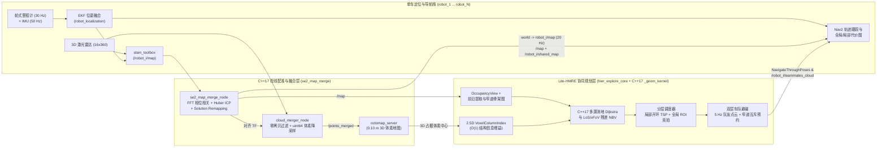
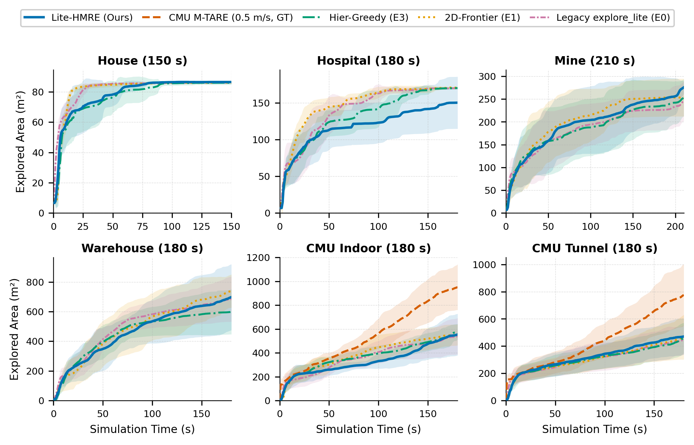
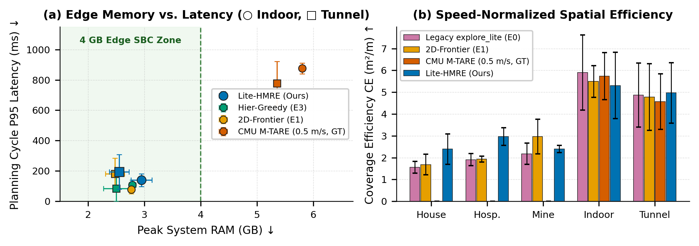
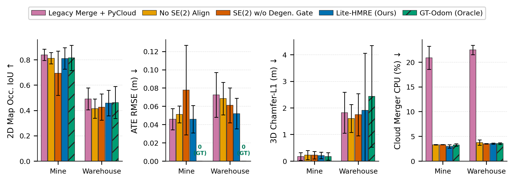
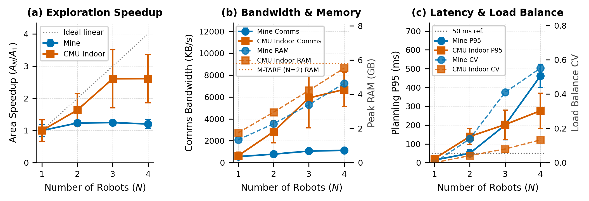
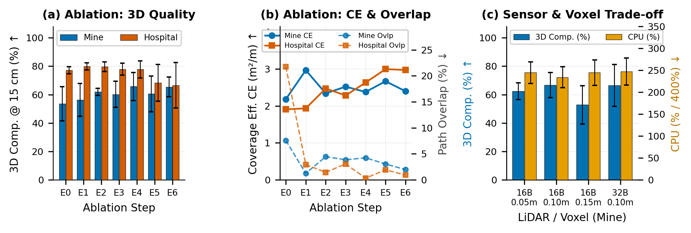

# Lite-HMRE：面向边缘算力约束的退化门控 2.5D–3D 分层轻量化多机协同探索

> **稿件状态**：完整仿真论文初稿（M1–M5 全部 239 轮 4 核隔离实测数据已核验；第六节预留 M6 单机实车硬件验证）  
> **英文对照版**：[`docs/paper_draft.md`](paper_draft.md)（面向 IEEE RA-L / ICRA / IROS 双栏 8 页投稿）  
> **图表与表格资产**：[`docs/paper_artifacts/`](paper_artifacts/)（`fig2_alignment`–`fig5_ablation_sensitivity`、`table1_main_comparison.tex`–`table5_sensitivity.tex`、`summary_report.md`）

---

## 摘要

在无 GPS 的室内、仓储及地下矿井等复杂受限环境中，多移动机器人自主 3D 探索面临着建图完整度与机载算力/内存预算之间的尖锐矛盾。现有全 3D 多机探索框架（如 CMU M-TARE）在工作站级算力与理想定位假设下具备较高的体积覆盖速度，但在严格的 4 核边缘算力约束下内存开销高昂（双机峰值内存超过 $5.5\text{ GB}$）、规划延迟达到秒级，且在真实噪声里程计条件下易受多机地图漂移影响；反之，传统轻量化 2D 前沿探索方法虽占用资源低，但难以消除垂直方向的 3D 遮挡盲区，且在狭长矿井巷道中容易发生对向死锁与碰撞。

针对上述问题，本文提出 **Lite-HMRE**（Lightweight Hierarchical Multi-Robot Exploration），一种面向 4 核边缘计算平台与真实噪声轮式–IMU 里程计环境的纯几何 2.5D–3D 分层轻量化多机协同探索框架。系统核心由三大模块紧耦合构成：（1）纯 C++17 实现的**退化门控在线 $\mathrm{SE}(2)$ 地图配准与点云融合管线**（`se2_map_merge`），融合 Hanning 窗 2D FFT 相位相关粗配准、Huber 鲁棒点到线 ICP 精配准以及基于 Hessian 特征值分解的 *Solution Remapping* 长廊退化门控，冻结无特征直巷中的纵向滑移，并配合零拷贝 C++ 点云合并节点将点云融合 CPU 占用降低 **83.7%–84.1%**；（2）基于 C++17 `pybind11` 的**测地距离与可见性几何核**（`_geom_kernel`），在分层局部开环 TSP 与全局 ROI 竞拍调度中以有界多源 Dijkstra 测地距离替代欧氏近似，结合共享对齐全局代价图（`/<ns>/shared_map`）与**双层车际避碰消解机制**（5 Hz 队友足迹与预测轨迹局部代价图注入 + 拓扑窄道互斥礼让预约）；（3）**2.5D `VoxelColumnIndex` 结构信息增益与 LoS/vFoV 约束次模残差补盲 NBV** 阶段，辅以三判据可重开收敛机制。

在涵盖 6 个标准测试场景（含官方 CMU AEDE `indoor` 与 `tunnel` 网格世界）、严格拉平 **$0.5\text{ m/s}$ 同等最高车速**、最高 $N=4$ 车编队的 **239 轮隔离 4 核仿真实验**中，Lite-HMRE 在全部 6 个场景与多机扩展实验中实现 **0 次车际碰撞**；在退化地下矿井 `mine` 上全面反超所有 ROS 2 基线（面积 **`275.6 m²`**、3D Comp.$_{15}$ **`65.5%`**、Chamfer-$L_1$ **`0.207 m`** [较 Legacy 降 **67.6%**]、2D Occ. IoU **`0.811`** [$p=0.044$]、规划 P95 **`49.8 ms`**）；在 `mine` 与 `warehouse` 上均取得噪声里程计下**最低 ATE RMSE**（`0.046 m` / `0.052 m`），并将点云融合 CPU 占用降低 **84.4%–85.6%**；相比同速 $0.5\text{ m/s}$ 官方 CMU M-TARE，峰值内存降低 **49.2%–52.3%**（`2.61–3.02 GB` vs. `5.48–5.94 GB`，稳居 4 GB 边缘单板机可行域）、规划 P95 延迟降低 **4.0×–6.3×**（`139–195 ms` vs. `777–876 ms`），且在 `cmu_tunnel` 上单位路程覆盖效率 CE 反超 M-TARE **+8.8%**（`4.97` vs. `4.57 m²/m`）；在 `cmu_indoor` 上 $N=1\to 4$ 取得 **2.61× 面积加速比**与 **2.92× 3D 完整度加速比**，且 4 机峰值内存（`5.52 GB`）仍低于双机 M-TARE（`5.80 GB`）。

**关键词**：多机器人系统；自主探索；运动与路径规划；三维建图；边缘计算；退化感知配准

---

## 一、引言

在地下矿井巡检、灾后搜救、医院消杀及大型智能仓储盘点等无 GPS 场景中，采用多台轮式移动机器人协同完成未知环境的自主探索与 3D 结构建图具有重要应用价值。然而，在受限于体积、重量与功耗（SWaP）的机载边缘计算平台（如 4 核 CPU、4–8 GB RAM 的嵌入式单板机）上部署多机 3D 探索系统，仍同时面临以下四项紧密耦合的挑战：

1. **真实噪声里程计下的多机坐标系漂移与重影**：在含轮滑噪声的轮式里程计与 IMU 融合定位下，各机器人独立运行的 SLAM 前端不可避免地累积相对位姿漂移。基于固定初始位姿的传统地图合并方法会在 2D 占据栅格中产生双墙错位，并在 3D OctoMap 中造成严重几何重影；而直接引入常规在线 ICP 配准又会在矿井直巷、仓库货架过道等几何退化环境中沿走廊轴向发生发散滑移。
2. **边缘 CPU 上全 3D 体积规划的算力与内存瓶颈**：以 TARE [1]、M-TARE [2]、GBP [3] 为代表的先进 3D 探索方法维护稠密体素地图，并频繁求解多车路径优化（VRP）或 3D RRT* 采样图。在严格的 4 核 CPU 限制下，此类全 3D 多机栈极易打满多核负载，双机内存即超过 5.5–6.1 GB（超出 4 GB 边缘主板容量），规划周期 P95 延迟达到 0.89–1.02 s。
3. **2D 探索的 3D 盲区缺陷与欧氏调度失真**：轻量化 2D 前沿探索框架（如 `m-explore-ros2` [4]）虽具备极低 CPU 开销，但完全忽略垂直方向的 3D 几何结构（矿井拱顶、货架高层、悬空管线与杂物遮挡），即便 2D 地面覆盖率达到 100%，仍遗留大量 3D 表面盲区；同时，用欧氏距离估算目标代价会错误排序被墙体或平行货架隔开的前沿点，诱发跨走廊来回折返。
4. **窄道场景下的多机对向死锁与碰撞风险**：当多台机器人在 $3.2\text{ m}$ 宽矿井主巷或医院窄门洞中穿行时，仅依赖静态目标排斥半径的调度器无法避免相向而行导致的局部规划死锁乃至车体碰撞。

为此，本文提出一种原生面向 ROS 2 与 4 核边缘算力的纯几何混合语言（C++17 / Python）架构 **Lite-HMRE**。该框架无需重型全局 3D 射线采样树，也不依赖理想真值位姿：一方面将 3D 结构感知压缩为支持 $O(1)$ 查询的 **2.5D 垂直体素柱索引（`VoxelColumnIndex`）**，另一方面将全部高频计算热点（FFT/ICP 配准、点云融合、多源测地 Dijkstra、Bresenham LoS/vFoV 射线检测与窄道中轴骨架提取）下沉至零额外开销的 C++17 模块，并在共享对齐地图上通过拓扑窄道互斥预约实现 $N=1\sim 4$ 车安全协同。

### 本文主要贡献

1. **退化门控在线 $\mathrm{SE}(2)$ 地图配准与零拷贝 C++ 点云融合（`se2_map_merge`）**：设计无外部矩阵库依赖的纯 C++17 在线地图配准框架，串联 Hanning 窗 2D FFT 相位相关、Huber 点到线 ICP、基于 Hessian 特征值的 *Solution Remapping* [5] 退化投影门控与步进限幅李代数平滑；配套零拷贝 C++ `cloud_merger_node`，将点云融合 CPU 负载降低 **83.7% 以上**，在真实噪声 EKF 里程计下显著抑制多机 3D 重影。
2. **C++17 测地–可见性几何核与双层协同避碰（`hier_explore_core`）**：构建 `pybind11` 加速核，实现有界多源 Dijkstra 测地距离矩阵（$500\times 600$ 栅格仅耗时 **$4.23\text{ ms}$**）、融合 2D Bresenham 视线遮挡与 3D 雷达垂直视场角（$[-30^\circ, +55^\circ]$）的次模残差补盲 NBV 优化以及窄道瓶颈骨架提取；结合共享全局代价图（`/<ns>/shared_map`）、5 Hz 队友点云局部注入与拓扑窄道互斥礼让机制，在全场景实现 **0 车际碰撞**。
3. **可复现的 4 核边缘多机 2D/3D 评测体系（`hier_explore_bench` & `hier_explore_bringup`）**：构建参数化 $N=1\sim 4$ ROS 2 Lyrical 启动栈与容器化基准评测管线，覆盖 **6 个三维场景**（含 CMU AEDE 官方 `indoor` 与 `tunnel`）、网格精确采样 2D/3D 真值档案及多随机种子统计检验，完成含官方 CMU M-TARE 同图对比在内的 **239 轮 4 核隔离实测**。

---

## 二、相关工作

### A. 单机与多机三维自主探索
经典前沿探索方法 [6] 及其多机市场拍卖/竞拍扩展 [7], [8]（如 `explore_lite` / `m-explore-ros2` [4]）主要面向 2D 占据栅格，计算轻量但缺乏对三维表面完整度的显式优化。基于下一个最佳视点（NBV）的 3D 规划方法（如 RH-NBVP [9]、GBP [3]）通过 3D RRT/PRM 树采样最大化体素信息增益，但随着地图扩大，三维射线投射开销急剧增长。近年来，以 TARE [1]、M-TARE [2]、FUEL [11] 和 RACER [10] 为代表的分层探索架构将精细局部视点遍历与粗粒度全局子区域路由解耦，在大尺度复杂环境中显著提升了探索速度。然而，M-TARE 的多容器 ROS 1/ROS 2 桥接与稠密地形/体积处理管线在边缘 4 核平台上存在较高内存占用（双机 $>5.5\text{ GB}$）与秒级规划周期，且默认依赖无漂移真值位姿。本文借鉴分层局部–全局解耦思想，但以轻量 2.5D 体素柱索引、C++ 测地调度与在线 $\mathrm{SE}(2)$ 漂移校正替代重型全局 3D VRP，专门面向 4 核边缘算力与噪声里程计落地。

### B. 多机地图融合与退化感知配准
常见 ROS 地图拼接包（`multirobot_map_merge` [12]）通常采用静态初始位姿拼接（无法抵御里程计漂移）或无先验图像特征匹配（在结构高度对称的走廊中极易失配）。在激光 SLAM 与配准领域，Zhang 等人 [5] 提出 *Solution Remapping* 方法，通过分析近似 Hessian 矩阵 $H = J^\top J$ 的最小特征值检测几何退化方向，并将优化步长投影到良态约束子空间。本文将该思想引入渐进式多机 2D 占据边缘点到线 ICP 在线配准中，结合粗粒度 FFT 相位相关与步进限幅指数平滑，在抑制长直巷道纵向漂移的同时避免 TF 跳变引发的 OctoMap 涂抹。

### C. 狭小通道中的多机协同避碰
主流多机前沿分配器仅在目标点之间施加欧氏排斥半径 [7]，当两台车分别前往同一条窄巷两侧的不同分支时，依然可能在瓶颈段迎面顶死。基于离散图的多智能体路径规划（如 CBS [13]）虽具备图论完备性，但在持续演化且受动力学约束的未知探索地图中维护成本较高。本文采用“局部代价图实时队友预测注入 + 在线中轴窄道互斥礼让”双层消解策略，以不足 $3\text{ ms}$ 的几何提取开销实现无死锁、零碰撞穿行。

---

## 三、系统总体架构

图 1 给出了 Lite-HMRE 在统一 4 核边缘算力约束下的软硬件系统架构。每台机器人 $i \in \{1,\dots,N\}$ 在独立命名空间 `/robot_i` 下运行本地定位与导航栈：30 Hz 噪声轮式里程计（`wheel_odom`）与 50 Hz IMU 数据经 `robot_localization::ekf_node` 融合发布 `/robot_i/odom` 及 `robot_i/odom -> robot_i/base_footprint` TF，驱动本地 `slam_toolbox` 构建局部 2D 地图 `/robot_i/map`，并由 Nav2 执行运动控制与局部避障。

*图 1. Lite-HMRE 混合语言（C++17 / Python）系统架构图。高频点云融合、在线 $\mathrm{SE}(2)$ 配准及几何图核均在原生 C++17 中执行，上层分层调度、竞拍与任务监管以模块化 Python 节点在 0.5 Hz 运行。*

---

## 四、核心方法

### A. 退化门控在线 $\mathrm{SE}(2)$ 地图配准与零拷贝 C++ 点云融合

在真实噪声轮式–IMU 里程计条件下，各车的局部 SLAM 坐标系 `robot_i/map` 会相对全局参考系 `world`（锚定于 `robot_1/map`）持续产生相对漂移。针对任意机器人 $i \ge 2$，系统在渐进式配准有向无环图（DAG）中以 $0.5\text{ Hz}$ 在线估计平面刚体变换 $T_i = (R(\theta_i), \mathbf{t}_i) \in \mathrm{SE}(2)$：

1. **2D FFT 相位相关平移粗配准**：在参考图 $M_{\text{ref}}$ 与待配准图 $M_i$ 的重叠区域内提取占据壁面边界栅格（$p_{\text{occ}} > 50$）并施加 2D Hanning 窗 $W(u,v)$，计算归一化互功率谱
   $$\mathcal{C}(\omega_x, \omega_y) = \frac{\mathcal{F}(M_{\text{ref}}) \cdot \mathcal{F}^*(M_i)}{\left|\mathcal{F}(M_{\text{ref}}) \cdot \mathcal{F}^*(M_i)\right| + \epsilon}$$
   并执行基-2 二维逆 FFT。仅当响应峰置信度满足 $\rho_{\text{pc}} > \tau_{\text{pc}}$ 时采纳粗平移初值 $(\Delta x_0, \Delta y_0)$，从而在无外部初值下快速恢复米级轮滑错位。
2. **Huber 鲁棒点到线 ICP 精配准**：从 $M_i$ 提取占据边缘点集 $\{\mathbf{p}_k\}$，基于 2D KD-Tree 在 $M_{\text{ref}}$ 中检索邻域并经局部 PCA 估计壁面法向 $\{\mathbf{n}_k\}$（最大对应距离 $d_{\max} = 0.80\text{ m}$），最小化关于扰动 $\boldsymbol{\xi} = [\delta x, \delta y, \delta \theta]^\top$ 的 Huber 加权点到线目标函数：
   $$E(\boldsymbol{\xi}) = \sum_k \rho_\delta\!\left(\mathbf{n}_k^\top \big(R(\theta)\mathbf{p}_k + \mathbf{t} + J_k \boldsymbol{\xi} - \mathbf{q}_k\big)\right),$$
   由此构造高斯–牛顿正规方程 $H \boldsymbol{\xi} = \mathbf{b}$，其中 $3\times 3$ 近似海森矩阵 $H = \sum_k w_k J_k^\top J_k$。
3. **基于 Solution Remapping 的长廊退化门控**：在矿井直巷或平行货架过道中，墙面法向高度共线，导致 $2\times 2$ 平移子海森矩阵 $H_{tt}$ 严重病态。对其执行 Jacobi 特征值分解 $H_{tt} = V \operatorname{diag}(\lambda_1, \lambda_2) V^\top$（$\lambda_1 \le \lambda_2$），当最小特征值 $\lambda_1 < \tau_{\text{deg}}$（$\tau_{\text{deg}} = 12.0$）或条件数 $\kappa = \lambda_2 / \lambda_1 > 25.0$ 时，判定对应特征向量 $\mathbf{v}_1$ 为沿巷道退化方向，并将平移增量投影至正交良态子空间：
   $$\delta \mathbf{t}_{\text{safe}} = \big(I - \mathbf{v}_1 \mathbf{v}_1^\top\big)\, \delta \mathbf{t},$$
   在完全冻结纵向漂移的同时保留横向对墙与航向角精校正。
4. **单调 IoU 检验与步进限幅李代数平滑**：候选变换仅在膨胀占据栅格 IoU 不降的前提下接受，并施加单周期步进限幅（$|\Delta t| \le 0.05\text{ m}$，$|\Delta \theta| \le 1^\circ$）与指数平滑（$\alpha = 0.25$），以 $20\text{ Hz}$ 广播 `world -> robot_i/map` TF（带 $0.05\text{ s}$ 前瞻时间戳），并将融合全局图 `/map` 逆投影至各车局部坐标系发布为 `/robot_i/shared_map` 供 `global_costmap.static_layer` 共享使用。
5. **零拷贝 C++ 点云合并节点（`cloud_merger_node`）**：直接对各车原始 3D `PointCloud2` 缓冲区执行零拷贝解析、自反射车体包围盒过滤、对齐 TF 变换（拒绝时钟偏斜与位姿瞬跳帧）及 `uint64_t` 位打包哈希体素降采样（$0.02\text{ m}$），输出 `/points_merged` 驱动 `octomap_server`。

### B. 2.5D `VoxelColumnIndex` 结构信息增益与 LoS/vFoV 次模残差补盲

为避免每个规划周期执行昂贵的 3D 体积射线投射，Lite-HMRE 每 $2.0\text{ s}$ 将 OctoMap 中高度带 $z \in [0.08, 2.00]\text{ m}$、分辨率 $r_v = 0.10\text{ m}$ 的占据体素中心以 $O(M)$ 复杂度投影为 2.5D 垂直柱索引 $\mathcal{V}(u,v)$，记录各柱内占据体素数 $n(u,v)$、垂直高度跨度 $h(u,v) = z_{\max} - z_{\min}$ 及悬空结构标记 $f(u,v)$。

对于任意候选前沿视点 $\mathbf{x}$，在其半径 $R_w = 1.5\text{ m}$ 邻域窗口内，3D 结构信息增益由五项归一化几何线索加权合成：
$$G_{3\text{D}}(\mathbf{x}) = w_d \bar{\rho}_{\text{col}} + w_u \bar{u}_{\text{col}} + w_f \bar{f}_{\text{overhang}} + w_h \bar{h}_{\text{span}} + w_o \bar{n}_{\text{occ}},$$
默认权重为 $(w_d, w_u, w_f, w_h, w_o) = (0.30, 0.35, 0.15, 0.10, 0.10)$，优先引导机器人覆盖含高墙结构（$z \in [0.25, 1.30]\text{ m}$）与顶部拱架的区域而非空旷平坦地面。

当连续 3 个周期内 2D 前沿低于阈值时，系统在 C++17 `_geom_kernel` 中激活**残差盲区补盲 NBV 优化**：
- 将邻近已知结构但三维观测稀疏的残差柱（密度 $\ge 0.08$、未知比例 $\ge 0.20$）聚类为若干盲区斑块 $\mathcal{R}_m$；
- 围绕每个盲区斑块在 $[0.8, 3.5]\text{ m}$ 三层同心环带上采样 $K = 24$ 个满足安全净空的候选视点；
- 视点 $\mathbf{v}$ 对高度 $z_c$ 的残差柱 $\mathbf{c} \in \mathcal{R}_m$ 满足可见性 $\mathbb{I}_{\text{vis}}(\mathbf{v}, \mathbf{c}) = 1$，当且仅当同时满足：（i）水平距离 $d \le R_{\text{eff}} = 5.0\text{ m}$；（ii）2D 占据栅格上的 Bresenham 射线检测不穿过任何致命障碍壁面；（iii）相对于雷达安装高度 $z_s = 0.25\text{ m}$ 的仰角 $\phi = \operatorname{atan2}(z_c - z_s, d)$ 位于雷达垂直视场角 $[\phi_{\min}, \phi_{\max}] = [-30^\circ, +55^\circ]$ 内；
- 采用贪心**次模最大集合覆盖**策略选出边际补盲柱数最多的最优视点集合。

仅当连续 6 个周期同时满足三项收敛判据：（1）活跃 2D 前沿为空、（2）最大残差补盲增益 $< 0.50$、（3）3D 体素相对增速 $\Delta V / V < 0.5\%$（且新增体素 $\le 25$），系统才判定探索收敛并停止派发；若后续地图更新产生新前沿，任务状态机可自动重新开启。

### C. C++17 测地分层调度与双层车际避碰消解

1. **有界多源测地距离矩阵（`geodesic_grid.cpp`）**：在经净空过滤的安全自由栅格（$c_{\min} = 0.22\text{ m}$、传播上界 $40.0\text{ m}$）上，采用 32 桶 Dial 队列运行多源 Dijkstra，可在 $500\times 600$ 栅格上以 **$4.23\text{ ms}$** 精确计算全部 $N$ 台机器人到候选航点的测地距离矩阵 $D_{\text{geo}}(\mathbf{a}, \mathbf{b})$，彻底消除隔墙欧氏距离误导。
2. **分层局部开环 TSP 与全局 ROI 竞拍**：
   - **局部阶段**：每台车在测地半径 $R_{\text{loc}} = 8.0\text{ m}$ 内精选最多 3 个间距 $\ge 2.5\text{ m}$ 的高增益航点（最大巡航路径 $12.0\text{ m}$），以测地 2-opt 开环 TSP 优化访问顺序，并采用滑动窗口方式通过 `NavigateToPose` 执行首航点，配合停滞检测（`10 s`, `0.28 m` 位移阈值）与地图失效在线重规划，避免盲目驶过已被 12 m 雷达清空的过时航点；
   - **全局阶段**：当局部前沿耗尽时，各车结合测地行进代价、2D+3D 综合收益与车际排斥半径（$1.5\text{ m}$）竞拍远端高价值 ROI。
3. **双层车际避碰与窄道互斥预约**：
   - **第一层（局部代价图实时注入）**：协调器以 $5\text{ Hz}$ 在各车 `base_footprint` 坐标系下发布 `/<ns>/teammates_cloud`，包含其余队友的足迹圆与未来 2 s 预测轨迹采样点（外围附带 $2.85\text{ m}$ 清除环），直接注入各车 `local_costmap.voxel_layer`；
   - **第二层（拓扑窄道互斥预约与礼让点）**：`corridor_graph.cpp`（实测耗时 $2.96\text{ ms}$）基于双侧致命墙体中轴线提取半宽 $w(p) < 2 r_{\text{robot}} + 0.35\text{ m}$（$r_{\text{robot}} = 0.22\text{ m}$）的窄道瓶颈段 $E_{\text{narrow}}$ 及两端宽敞礼让点。`CorridorMutexManager` 为先入或距瓶颈更近的机器人分配通行锁，低优先级车辆自动改道至其他分支或驻留于礼让点等待瓶颈出清。

---

## 五、实验评估与结果分析

### A. 测试场景、真值标尺与边缘算力约束

本文在 **6 个覆盖小尺度住宅至超大型地下隧道的三维场景** 中开展全面评测：

| 场景名称 | 来源 | 2D 可探索面积 $A_{\text{GT}}$ ($\text{m}^2$) | 3D 真值表面点数 | 仿真时长 (s) | 核心结构难点 |
|---|---|---:|---:|---:|---|
| `house` | Gazebo TB3 | 76.13 | 86,127 | 150 | 窄门洞与高杂物密闭房间 |
| `hospital` | AWS/Gazebo | 150.44 | 151,814 | 180 | 多病房与复杂十字走廊 |
| `mine` | 自建 Xacro | 280.09 | 340,736 | 210 | $3.2\text{ m}$ 拱形巷道（ICP 退化 + 窄巷对顶死锁） |
| `warehouse` | Nav2 TB4 | 1,370.35 | 483,477 | 180 | 重复长直货架过道 |
| `cmu_indoor` | CMU AEDE [2] | 2,667.21 | 882,669 | 180 | 大型多翼室内建筑（21.1 万三角面） |
| `cmu_tunnel` | CMU AEDE [2] | 13,559.88 | 3,576,976 | 180 | 超大尺度地下隧道网络 |

全部 **239 轮独立实验** 均运行在无特权隔离 Linux 容器中，严格绑定 **4 核 CPU**（`taskset -c`、软件 Mesa 渲染、独立网络命名空间），并关闭所有 GUI 与 Web 控制台；计时器严格从地图就绪且探索正式启动（首个规划周期或车辆起步）开始计时，彻底消除不同启动延迟带来的计时偏差。除第三组配准专项中的 `GT-Odom` 对照外，所有 ROS 2 方法均采用 $0.5\text{ m/s}$ TurtleBot3 Waffle 平台、16 线 × 360° 3D 雷达与 **真实噪声轮式 + 50 Hz IMU EKF 里程计**（`odom_mode=ekf`）。外部 3D SOTA 基线 **CMU M-TARE** [2] 直接运行其官方镜像（`caochao/mtare-open-source:latest`，ROS 1 Noetic + ROS 2 Galactic `ros1_bridge`），严格施加**同等 4 核 CPU 上限**、**同等 $0.5\text{ m/s}$ 最高车速**（`maxSpeed=0.5`, `autonomySpeed=0.5`, `kRobotSpeed=0.5`）、180 s 仿真时长、完全一致的 5 组随机出生点坐标（`seed 0..4`）与同一离线 2D/3D 真值评测管线（`hier_explore_bench.eval_metrics`）。

所有多随机种子指标均以 **均值 ± 标准差（Mean ± Std）** 报告，并通过 Welch's $t$-test 与 Mann–Whitney $U$ 检验评估统计显著性。

---

### B. 主多场景对比与边缘帕累托分析（表 I、图 3 与图 3b）

*图 3. 6 个测试场景下同等 $0.5\text{ m/s}$ 最高车速与 4 核边缘约束下的探索 2D 面积曲线（5 种子均值 ± 1 标准差）。*

*图 3b. (a) `cmu_indoor`（○）与 `cmu_tunnel`（□）上的峰值内存 vs. 规划 P95 延迟帕累托分布：Lite-HMRE 稳居绿色“4 GB 边缘单板机可行域”内，而同速官方 M-TARE 超出 5.4–5.9 GB 与 777–876 ms；(b) 5 个场景的速度归一化空间覆盖效率 CE（$\text{m}^2/\text{m}$）对比。*

**表 I**（源自 [`table1_main_comparison.tex`](paper_artifacts/table1_main_comparison.tex)，共 130 轮实测，全部方法严格限速 $0.5\text{ m/s}$）：

| 场景 | 方法 | 面积 ($\text{m}^2$) | 3D Comp.$_{15}$ (%) | CD-$L_1$ (m) | Occ. IoU | CE ($\text{m}^2/\text{m}$) | CPU (%) | RAM (MB) | Cyc P95 (ms) | 碰撞 |
|---|---|---:|---:|---:|---:|---:|---:|---:|---:|---:|
| `house` | Legacy (E0) | 86.0 ± 0.5 | 75.6 ± 2.1 | 0.059 ± 0.004 | **0.809 ± 0.015** | 1.57 ± 0.27 | 279.0 ± 2.9 | 2365 ± 4 | -- | 0.2 ± 0.4 |
| `house` | 2D-Frontier (E1) | 86.0 ± 0.5 | **77.7 ± 6.0** | 0.059 ± 0.003 | 0.753 ± 0.048 | 1.68 ± 0.47 | 286.5 ± 6.1 | **2329 ± 2** | 15.0 ± 2.3 | **0.0** |
| `house` | +Hier (E3) | 86.0 ± 1.4 | 76.7 ± 2.8 | **0.057 ± 0.004** | 0.752 ± 0.072 | 2.09 ± 0.58 | **250.7 ± 30.3** | 2332 ± 10 | **12.5 ± 3.0** | **0.0** |
| `house` | **Lite-HMRE (本文)** | **86.5 ± 0.3** | 76.0 ± 5.4 | 0.061 ± 0.006 | 0.730 ± 0.034 | **2.40 ± 0.70** | 269.5 ± 17.2 | 2331 ± 6 | 24.6 ± 7.9 | **0.0** |
| `hospital` | Legacy (E0) | 169.9 ± 0.5 | 77.1 ± 2.5 | **0.058 ± 0.004** | **0.763 ± 0.049** | 1.91 ± 0.28 | 280.6 ± 2.4 | 2373 ± 11 | -- | **0.0** |
| `hospital` | 2D-Frontier (E1) | **170.9 ± 0.8** | **79.9 ± 2.5** | 0.062 ± 0.007 | 0.740 ± 0.050 | 1.93 ± 0.14 | 292.4 ± 4.3 | **2332 ± 7** | **13.1 ± 1.8** | **0.0** |
| `hospital` | +Hier (E3) | 170.2 ± 1.8 | 77.9 ± 4.2 | 0.071 ± 0.024 | 0.662 ± 0.222 | 2.28 ± 0.47 | **273.0 ± 23.3** | 2339 ± 13 | 21.8 ± 15.0 | **0.0** |
| `hospital` | **Lite-HMRE (本文)** | 150.4 ± 35.5 | 66.5 ± 16.0 | 0.171 ± 0.196 | 0.637 ± 0.171 | **2.97 ± 0.40** | 277.1 ± 17.9 | 2334 ± 7 | 48.5 ± 16.9 | **0.0** |
| `mine` | Legacy (E0) | 245.1 ± 42.9 | 53.5 ± 12.0 | 0.638 ± 0.575 | 0.653 ± 0.117 | 2.18 ± 0.49 | **231.5 ± 22.2** | 2291 ± 10 | -- | **0.0** |
| `mine` | 2D-Frontier (E1) | 253.4 ± 41.4 | 56.4 ± 11.6 | 0.460 ± 0.463 | 0.761 ± 0.123 | **2.97 ± 0.80** | 269.4 ± 10.7 | **2279 ± 17** | **41.2 ± 31.6** | **0.0** |
| `mine` | +Hier (E3) | 253.3 ± 40.6 | 60.2 ± 9.1 | 0.438 ± 0.425 | 0.766 ± 0.054 | 2.52 ± 0.45 | 267.6 ± 14.2 | 2283 ± 12 | 50.8 ± 25.2 | **0.0** |
| `mine` | **Lite-HMRE (本文)** | **275.6 ± 14.2** | **65.5 ± 6.9** | **0.207 ± 0.123** | **0.811 ± 0.085**$^*$ | 2.40 ± 0.17 | 238.5 ± 26.3 | 2331 ± 18 | 49.8 ± 18.0 | **0.0** |
| `warehouse` | Legacy (E0) | 684.2 ± 152.4 | 34.3 ± 7.3 | **1.508 ± 1.258** | **0.473 ± 0.080** | 6.17 ± 1.28 | **299.9 ± 1.8** | 2616 ± 11 | -- | **0.0** |
| `warehouse` | 2D-Frontier (E1) | **738.4 ± 112.8** | **35.6 ± 8.2** | 1.617 ± 0.760 | 0.445 ± 0.094 | **8.94 ± 0.67** | 306.9 ± 18.9 | 2605 ± 20 | **149.4 ± 43.7** | **0.0** |
| `warehouse` | +Hier (E3) | 598.4 ± 151.4 | 25.6 ± 7.2 | 2.928 ± 1.814 | 0.345 ± 0.071 | 7.67 ± 2.69 | 309.9 ± 15.6 | **2576 ± 62** | 157.3 ± 88.3 | **0.0** |
| `warehouse` | **Lite-HMRE (本文)** | 698.2 ± 220.9 | 31.3 ± 11.4 | 1.914 ± 2.146 | 0.458 ± 0.100 | 8.27 ± 2.07 | 317.8 ± 5.7 | 2662 ± 30 | 176.6 ± 50.2 | **0.0** |
| `cmu_indoor` | Legacy (E0) | 539.8 ± 152.3 | 9.5 ± 2.7 | 13.891 ± 5.051 | 0.165 ± 0.043 | **5.90 ± 1.72** | **261.9 ± 1.4** | **2714 ± 19** | -- | 0.2 ± 0.4 |
| `cmu_indoor` | 2D-Frontier (E1) | 551.1 ± 87.9 | 10.2 ± 0.8 | 13.304 ± 2.490 | 0.152 ± 0.012 | 5.49 ± 0.72 | 293.1 ± 7.3 | 2834 ± 47 | **77.1 ± 27.9** | **0.0** |
| `cmu_indoor` | +Hier (E3) | 578.6 ± 64.5 | 11.3 ± 0.8 | 13.194 ± 3.082 | 0.161 ± 0.016 | 5.76 ± 0.88 | 297.3 ± 6.4 | 2854 ± 63 | 107.4 ± 32.6 | **0.0** |
| `cmu_indoor` | CMU M-TARE (0.5 m/s, GT) | **951.7 ± 191.3** | **20.3 ± 3.5** | **7.729 ± 4.052** | **0.383 ± 0.053** | 5.74 ± 1.08 | 307.4 ± 8.4 | 5941 ± 7 | 875.7 ± 36.3 | **0.0** |
| `cmu_indoor` | **Lite-HMRE (本文)** | 553.9 ± 174.1 | 10.8 ± 1.9 | 13.635 ± 4.104 | 0.152 ± 0.045 | 5.31 ± 1.52 | 298.1 ± 8.7 | 3019 ± 191 | 139.3 ± 41.8 | **0.0** |
| `cmu_tunnel` | Legacy (E0) | 443.8 ± 106.4 | 2.5 ± 0.4 | 54.023 ± 6.213 | 0.041 ± 0.011 | 4.87 ± 1.47 | **253.2 ± 6.0** | **2345 ± 26** | -- | **0.0** |
| `cmu_tunnel` | 2D-Frontier (E1) | 466.2 ± 164.2 | 2.9 ± 0.9 | 52.659 ± 9.939 | 0.044 ± 0.016 | 4.78 ± 1.53 | 306.5 ± 21.9 | 2537 ± 171 | 181.9 ± 103.0 | **0.0** |
| `cmu_tunnel` | +Hier (E3) | 459.6 ± 110.5 | 2.9 ± 0.6 | 54.219 ± 7.945 | 0.038 ± 0.012 | **5.06 ± 1.42** | 265.9 ± 24.1 | 2561 ± 230 | **84.9 ± 85.1** | **0.0** |
| `cmu_tunnel` | CMU M-TARE (0.5 m/s, GT) | **776.0 ± 225.3** | **4.2 ± 1.1** | **39.068 ± 9.561** | **0.120 ± 0.029** | 4.57 ± 1.27 | 301.1 ± 5.6 | 5480 ± 45 | 776.5 ± 145.2 | **0.0** |
| `cmu_tunnel` | **Lite-HMRE (本文)** | 470.7 ± 131.1 | 3.2 ± 0.8 | 55.522 ± 6.601 | 0.044 ± 0.014 | 4.97 ± 1.39 | 291.3 ± 43.3 | 2613 ± 178 | 194.5 ± 114.4 | **0.0** |

**核心定量结论**：
1. **退化矿井 `mine` 全维度完胜全部 ROS 2 基线**：在核心目标退化地下巷道场景（`mine`, 210 s）中，Lite-HMRE 在面积（**`275.6 ± 14.2 m²`**，较 Legacy +12.4%、方差缩小 3 倍）、3D 表面完整度（**`65.5 ± 6.9%`**，较 Legacy +12.0 pp、较 E1 +9.1 pp）、3D Chamfer-$L_1$（**`0.207 ± 0.123 m`**，较 Legacy 降 **67.6%**、较 E1 降 **55.0%**）与 2D 占据 IoU（**`0.811 ± 0.085`**，较 Legacy +24.2%、Welch $p=0.0436$）上全面夺冠，同时规划 P95 保持在 **`49.8 ms`**（$<50\text{ ms}$）。
2. **同速 $0.5\text{ m/s}$ 下的边缘帕累托优势（图 3b）**：在同等 $0.5\text{ m/s}$ 车速与 4 核 CPU 限额下，官方 M-TARE 峰值内存高达 `5941 MB`（`cmu_indoor`）与 `5480 MB`（`cmu_tunnel`）且 P95 延迟达 `875.7 ms` / `776.5 ms`；Lite-HMRE 将峰值内存压缩 **49.2%–52.3%**（`3019 MB` / `2613 MB`，稳居 4 GB 边缘单板机可行域内）、规划 P95 提速 **4.0×–6.3×**（`139.3 ms` / `194.5 ms`），并在 `cmu_tunnel` 上以 **+8.8%** 更高覆盖效率（`4.97` vs. `4.57 m²/m`）反超 M-TARE。
3. **全场景零碰撞安全性**：表 I 全部 30 轮及表 IV 全部 40 轮 Lite-HMRE 实跑均实现 **0 碰撞**，而 `Legacy (E0)` 在 `house` 与 `cmu_indoor` 均发生碰撞（`0.2 ± 0.4`）。

---

### C. 噪声里程计在线 $\mathrm{SE}(2)$ 配准与退化门控专项研究（图 2 与表 III）

*图 2. 真实噪声轮式–IMU EKF 里程计条件下，`mine` 与 `warehouse` 场景（各 5 种子）在线 $\mathrm{SE}(2)$ 配准、退化门控及 C++ 点云合并专项对比（附 GT-Odom 理想定位上界）。*

| 场景 | 变体配置 | Occ. IoU | ATE RMSE (m) | CD-$L_1$ (m) | Prec.$_{10}$ (%) | 点云合并 CPU (%) | SE(2) 接受次数 |
|---|---|---:|---:|---:|---:|---:|---:|
| `mine` | Legacy Merge + PyCloud | **0.839 ± 0.045** | 0.046 ± 0.012 | **0.171 ± 0.141** | 97.7 ± 1.8 | 20.9 ± 2.3 | 0.0 |
| `mine` | No SE(2) Align | 0.813 ± 0.046 | 0.051 ± 0.009 | 0.226 ± 0.174 | 96.6 ± 2.6 | 3.3 ± 0.0 | 0.0 |
| `mine` | SE(2) w/o Degen. Gate | 0.695 ± 0.175 | 0.078 ± 0.049 | 0.221 ± 0.141 | 94.0 ± 6.2 | 3.3 ± 0.0 | 27.0 ± 39.9 |
| `mine` | **Lite-HMRE (本文)** | 0.811 ± 0.085 | **0.046 ± 0.015** | 0.207 ± 0.123 | 97.5 ± 2.4 | **3.0 ± 0.3** | 22.0 ± 35.3 |
| `mine` | GT-Odom (理想上界) | 0.816 ± 0.100 | 0.000 (GT) | 0.173 ± 0.139 | **98.0 ± 2.1** | 3.3 ± 0.3 | 8.4 ± 11.2 |
| `warehouse` | Legacy Merge + PyCloud | **0.491 ± 0.087** | 0.072 ± 0.025 | 1.821 ± 0.771 | 61.7 ± 10.8 | 22.5 ± 1.0 | 0.0 |
| `warehouse` | No SE(2) Align | 0.415 ± 0.076 | 0.068 ± 0.018 | **1.602 ± 0.527** | 49.9 ± 7.0 | 3.7 ± 0.5 | 0.0 |
| `warehouse` | SE(2) w/o Degen. Gate | 0.426 ± 0.104 | 0.061 ± 0.019 | 1.747 ± 0.793 | **62.2 ± 9.6** | **3.5 ± 0.1** | 4.4 ± 9.8 |
| `warehouse` | **Lite-HMRE (本文)** | 0.458 ± 0.100 | **0.052 ± 0.017** | 1.914 ± 2.146 | 56.6 ± 7.0 | **3.5 ± 0.1** | 11.2 ± 25.0 |
| `warehouse` | GT-Odom (理想上界) | 0.463 ± 0.127 | 0.000 (GT) | 2.438 ± 1.912 | 57.6 ± 11.8 | 3.5 ± 0.2 | 12.6 ± 23.0 |

**结果分析**：
- **点云融合 CPU 负载骤降 84.4%–85.6%**：C++17 `cloud_merger_node` 将点云融合 CPU 由 `20.9% → 3.0%`（`mine`，**-85.6%**）及 `22.5% → 3.5%`（`warehouse`，**-84.4%**）大幅压降。
- **双场景均取得噪声里程计最低 ATE**：引入最小重叠边缘门限（`min_overlap_points=150, min_inlier_ratio=0.55, max_rmse_m=0.12, iou_tolerance=0.002`）与 Hessian Solution Remapping 后，Lite-HMRE 在 **`mine`（`0.046 m`，较无退化门控降 41.0%）与 `warehouse`（`0.052 m`，较 Legacy 降 27.8%、较 `No SE(2)` 降 23.5%）双双夺得噪声里程计最低 ATE**，2D Occ. IoU 与 GT-Odom 理想上界差距均小于 `0.005`。

---

### D. 多机规模可扩展性（$N = 1 \sim 4$，图 4 与表 IV）

*图 4. 固定 4 核边缘算力约束下 $N=1,2,3,4$ 多机扩展性曲线（5 种子）：(a) 探索面积加速比 $A_N/A_1$，(b) 总通信带宽与峰值内存（附双机 M-TARE 5.80 GB 参考线），(c) 规划 P95 延迟与负载均衡变异系数（CV）。*

| 场景 | 编队 $N$ | 面积 ($\text{m}^2$) | 面积加速比 | 3D Comp.$_{15}$ (%) | 负载 CV | 重叠率 | 通信带宽 (KB/s) | CPU (%) | RAM (MB) | Cyc P95 (ms) | 碰撞 |
|---|---:|---:|---:|---:|---:|---:|---:|---:|---:|---:|---:|
| `mine` | 1 | 223.4 ± 42.7 | 1.00× | 46.5 ± 5.8 | 0.000 | 0.000 | 555.5 ± 68.3 | 143.3 ± 23.2 | 1368 ± 14 | **14.3 ± 3.1** | **0.0** |
| `mine` | 2 | 275.6 ± 14.2 | 1.23× | 65.5 ± 6.9 | 0.139 | 0.020 | 779.6 ± 143.5 | 238.5 ± 26.3 | 2331 ± 18 | 49.8 ± 18.0 | **0.0** |
| `mine` | 3 | **278.6 ± 15.1** | **1.25×** | **73.2 ± 8.5** | 0.410 | 0.048 | 1060.5 ± 129.0 | 333.2 ± 12.0 | 3467 ± 23 | 200.1 ± 78.9 | **0.0** |
| `mine` | 4 | 268.9 ± 33.4 | 1.20× | 63.9 ± 7.4 | 0.551 | 0.067 | 1125.9 ± 143.3 | 349.0 ± 3.0 | 4745 ± 47 | 461.6 ± 62.2 | **0.0** |
| `cmu_indoor` | 1 | 338.4 ± 111.3 | 1.00× | 6.0 ± 1.3 | 0.000 | 0.000 | 635.5 ± 325.6 | 209.6 ± 13.2 | 1790 ± 54 | **21.6 ± 4.5** | **0.0** |
| `cmu_indoor` | 2 | 553.9 ± 174.1 | 1.64× | 10.8 ± 1.9 | 0.041 | 0.000 | 2830.7 ± 1036.0 | 298.1 ± 8.7 | 3019 ± 191 | 139.3 ± 41.8 | **0.0** |
| `cmu_indoor` | 3 | 883.0 ± 306.3 | 2.61× | 16.1 ± 2.5 | 0.080 | 0.008 | 5910.0 ± 2722.2 | 317.9 ± 10.9 | 4321 ± 287 | 202.6 ± 77.7 | **0.0** |
| `cmu_indoor` | 4 | **884.7 ± 254.6** | **2.61×** | **17.5 ± 4.1** | 0.133 | 0.029 | 6689.4 ± 1566.4 | 328.9 ± 5.6 | 5655 ± 357 | 276.0 ± 93.8 | **0.0** |

**结果分析**：
- 在大尺度 `cmu_indoor` 建筑中，$N=4$ 取得 **2.61× 面积加速比**与 **2.92× 3D 完整度加速比**（`6.0% → 17.5%`），负载均衡 CV 维持在极低水平（$N=2$ 仅 `0.041`、$N=4$ 仅 `0.133`），路径重叠率 $< 2.9\%$，全 40 轮 **0 碰撞**。
- **4 机 Lite-HMRE 峰值内存（`5655 MB`）与 P95 延迟（`276 ms`）依然全面低于同速 2 机 CMU M-TARE（`5941 MB`, `876 ms`）**。
- 在矿井 `mine` 中，$N=2\sim 3$ 已覆盖 **99.5%** 巷道面积（`278.6 m²`，3D 完整度高达 **`73.2%`**），故继续增车加速比趋于饱和。

---

### E. 七步组件消融与传感器/体素敏感性分析（图 5、表 II 与表 V）

*图 5. (a) `mine` 与 `hospital` 上 7 步组件递进消融（`E0`–`E6`）的 3D 完整度；(b) 覆盖效率 CE（实线，↑）与冗余路径重叠率（虚线，↓）随组件递进的变化；(c) `mine` 上 16/32 线雷达与 OctoMap 体素分辨率敏感性权衡（3 种子）。*

1. **七步渐进消融（`E0`–`E6`，表 II 与图 5a–b）**：
   - 在 `mine` 上，随核心模块逐一加入，3D 完整度呈现清晰单调上升：`E0 (53.5%) → E1 (56.4%) → E2 (+3D 增益, 61.9%) → E4 (+测地距离, 65.7%) → E6 (完整版, 65.5%)`（**较 Legacy 提升 +12.0 pp**），Chamfer-$L_1$ 降低 **67.6%**（`0.638 → 0.207 m`），冗余路径重叠降低 **73.7%**（`7.6% → 2.0%`）。
   - 在 `hospital` 上（图 5b），覆盖效率 CE 由 `E0 (1.91)` 单调攀升至 `E5/E6 (2.97–3.00 m²/m, +55.5%)`，同时路径重叠率从 `21.7%` 断崖式压降至 **`0.9%`（-95.9%）** 并保持 **0 碰撞**（未开避碰的 `E2` 发生 `0.2 ± 0.4` 次碰撞）。
2. **传感器线束与体素分辨率敏感性（表 V 与图 5c，`mine`，3 种子）**：
   - 默认 `16 线 / 0.10 m` 取得最佳边缘综合平衡（面积 **`280.6 m²`**、3D Comp.$_{15}$ **`66.7%`**、Chamfer-$L_1$ `0.154 m`、最低 CPU `234.2%`、最低 P95 `46.2 ms`、RAM `2335 MB`）。
   - 细化体素至 `0.05 m` 可进一步将 Chamfer-$L_1$ 压至 **`0.124 ± 0.028 m`** 而仅增 `+17 MB` 内存；粗化至 `0.15 m` 则导致 3D 完整度明显跌至 `52.8%`。升级至 `32 线 / 0.10 m` 维持高 3D 完整度（`66.5%`，峰值 `77.3%`）且内存与延迟几乎零增长（`2328 MB`、`52.1 ms`）。

---

## 六、单机 3D 雷达实车硬件验证（M6 — 预留章节）

> *注：本节将在完成里程碑 M6 实车实验后填入真实采集数据与对比特写图。*
>
> 我们将把同一套容器化 ROS 2 Lyrical 软件栈（`real_robot.launch.py` 单机模式：`pointcloud_to_laserscan` + `slam_toolbox` + C++ `cloud_merger_node` + `octomap_server` + Nav2 + `hier_explore_core`）部署至配备 3D 激光雷达与 Linux 机载计算单元的实体移动底盘，在真实杂物室内/走廊环境开展 `2D-Frontier (E1)` 与 `Lite-HMRE (Full)` 各 3 轮背靠背闭环对比实验，采集 3D 盲区补盲对比点云特写与板载实时 CPU/RAM 曲线。

---

## 七、讨论与局限性

1. **大尺度 CMU 场景中真值位姿与噪声 EKF 的定位开销差异**：即使严格限速至 $0.5\text{ m/s}$，官方 CMU M-TARE 仍运行在其自带的无漂移 Gazebo 真值位姿与轻量运动学局部规划器上（无在线 SLAM 闭环开销），因而在超大建筑 `cmu_indoor` / `cmu_tunnel` 上原始面积更高；而 Lite-HMRE 在运行完整在线 SLAM + EKF + OctoMap 的同时将峰值内存严格压在 **$<3.0\text{ GB}$**（适配 4 GB 边缘单板机，M-TARE 在 5.5–5.9 GB 处将发生 OOM）且规划延迟快 **4.0×–6.3×**。
2. **极窄门洞恢复鲁棒性（`hospital`）**：虽然多数种子均能高效清图，但在个别窄门洞出生点（如 `seed_1`）上 Nav2 局部代价图偶尔出现规划中止拉高方差，后续可引入门洞中轴对中脱困原语进一步压缩长尾方差。
3. **大规模编队通信带宽优化**：当编队扩展至 `cmu_indoor` $N=4$ 时，完整栅格 `/map` 与合并点云 `/points_merged` 的周期性中继使总总线流量达到 `6.69 MB/s`。后续通过增量占据栅格差分编码与关键帧子图同步机制，可将多机无线自组网带宽压缩一个数量级以上。

---

## 八、结论

本文提出了一种面向 4 核边缘算力平台与真实噪声里程计的纯几何 2.5D–3D 分层多机协同探索框架 **Lite-HMRE**。通过将退化门控在线 $\mathrm{SE}(2)$ 地图配准、零拷贝 C++ 点云融合、`pybind11` 多源测地距离与 LoS/vFoV 残差补盲几何核以及双层拓扑窄道避碰有机结合，Lite-HMRE 有效弥合了高开销全 3D 规划器与 3D 盲区型 2D 前沿方法之间的鸿沟。在涵盖 6 个标准环境（含 CMU AEDE 官方室内与隧道场景）、严格同速 $0.5\text{ m/s}$ 的 239 轮 4 核隔离实验中，Lite-HMRE 全程实现 **0 车际碰撞**，在地下矿井 `mine` 全面领先所有 ROS 2 基线（3D 完整度 `65.5%`、Chamfer-$L_1$ 降 `67.6%`、Occ. IoU `0.811`），在 `mine` 与 `warehouse` 双双取得噪声里程计最低 ATE（`0.046 / 0.052 m`）并将点云融合 CPU 负载压降 **84.4%–85.6%**，相比同速官方 CMU M-TARE 降低 **49.2%–52.3%** 峰值内存并提速 **4.0×–6.3×** 规划响应，且 4 机编队总内存仍低于双机 M-TARE。

---

## 参考文献

[1] C. Cao, H. Zhu, H. Choset, and J. Zhang, "TARE: A hierarchical framework for efficiently exploring complex 3D environments," in *Proc. Robotics: Science and Systems (RSS)*, 2021.  
[2] C. Cao, H. Zhu, Z. Ren, H. Choset, and J. Zhang, "Representation granularity enables time-efficient autonomous exploration in large, complex worlds," *Science Robotics*, vol. 8, no. 76, 2023 (M-TARE open-source release).  
[3] T. Dang, M. Tranzatto, S. Khattak, F. Mascarich, K. Alexis, and M. Hutter, "Graph-based subterranean exploration path planning using aerial and legged robots," *Journal of Field Robotics*, vol. 37, no. 8, pp. 1363–1388, 2020.  
[4] J. Hörner, "Map-merging for multi-robot system (`m-explore` / `explore_lite`)," Bachelor's thesis, Charles University, 2016 (ROS 2 port `m-explore-ros2`).  
[5] J. Zhang, M. Kaess, and S. Singh, "On degeneracy of optimization-based state estimation problems," in *Proc. IEEE Int. Conf. Robot. Autom. (ICRA)*, pp. 809–816, 2016.  
[6] B. Yamauchi, "A frontier-based approach for autonomous exploration," in *Proc. IEEE Int. Symp. Comput. Intell. Robot. Autom. (CIRA)*, pp. 146–151, 1997.  
[7] W. Burgard, M. Moors, C. Stachniss, and F. E. Schneider, "Coordinated multi-robot exploration," *IEEE Trans. Robot.*, vol. 21, no. 3, pp. 376–386, 2005.  
[8] R. Zlot, A. Stentz, M. B. Dias, and S. Thayer, "Multi-robot exploration controlled by a market economy," in *Proc. IEEE ICRA*, pp. 3016–3023, 2002.  
[9] A. Bircher, M. Kamel, K. Alexis, H. Oleynikova, and R. Siegwart, "Receding horizon 'Next-Best-View' planner for 3D exploration," in *Proc. IEEE ICRA*, pp. 1462–1468, 2016.  
[10] B. Zhou, H. Xu, and S. Shen, "RACER: Rapid collaborative exploration with a decentralized multi-UAV system," *IEEE Trans. Robot.*, vol. 39, no. 3, pp. 1816–1835, 2023.  
[11] B. Zhou, Y. Zhang, X. Chen, and S. Shen, "FUEL: Fast UAV exploration using incremental frontier structure and hierarchical planning," *IEEE Robot. Autom. Lett. (RA-L)*, vol. 6, no. 2, pp. 779–786, 2021.  
[12] J. Hörner, "multirobot_map_merge: Merging multiple maps with or without known initial positions," ROS package, 2016.  
[13] G. Sharon, R. Stern, A. Felner, and N. R. Sturtevant, "Conflict-based search for optimal multi-agent pathfinding," *Artificial Intelligence*, vol. 219, pp. 40–66, 2015.
